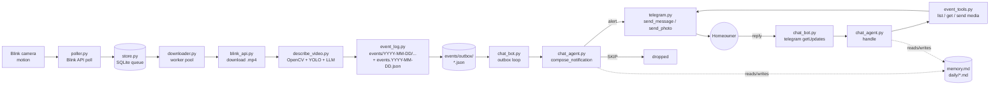

# vdemo — Architecture Overview

vdemo is a Blink-camera watcher that turns raw motion clips into structured
events, decides which events are worth interrupting the homeowner for, and
lets the homeowner chat back via Telegram to ask for pictures, videos, or
context.

This document is the top of the architecture tree. Each section links to a
deeper doc that covers one concern in detail.

## High-level flow



Two pipelines share a single `ChatAgent` instance:

- **Video pipeline** — polls Blink, downloads clips, runs the describer,
  writes events to disk, and drops a prompt into `events/outbox/` for every
  new event that might warrant an alert.
- **Chat pipeline** — `chat_bot.py` runs two async tasks: an outbox loop
  that feeds new events through `ChatAgent.compose_notification`, and a
  Telegram long-poll loop that feeds incoming user messages through
  `ChatAgent.handle`.

## Sub-documents

- **[Video analysis](video_analysis.md)** — `describe_video.py` and the
  OpenCV → YOLO → LLM pipeline that turns one `.mp4` into a structured
  description with a thumbnail and keyframes. Already documented in detail.
- **[Event loading](event_loading.md)** — how new clips travel from
  `poller.py` through the `store.py` SQLite queue, get downloaded by
  `downloader.py`, processed by `event_log.py`, and land in
  `events/YYYY-MM-DD/.../` plus the outbox.
- **[Chatbots](chatbots.md)** — the two roles of `ChatAgent`: the
  proactive **notifier** (`compose_notification`) that decides whether a
  new event deserves an alert, and the interactive **chat agent**
  (`handle`) that answers Telegram messages from the homeowner. Covers
  the Telegram I/O loop, the tool-call round-trip, and the `SKIP:` /
  `SILENT` sentinels.
- **[Prompt construction](prompt_construction.md)** — how system prompts
  are loaded from `prompts/*.txt`, how `_system_with_memory` injects the
  current date, persistent memory, and pre-fetched day notes, and how
  the chat vs notify tool sets differ.
- **[Memory](memory.md)** — the two memory stores: persistent
  `state_dir/memory.md` (identity-level facts) and per-day
  `state_dir/daily/YYYY-MM-DD.md` (ephemeral scratchpad). Covers read
  paths, write paths, the `identified:` / `alerted:` / `alert-on:`
  canonical line formats, and how the active day is resolved
  automatically from the latest event date on disk.

## Module map

| Module | Role |
| --- | --- |
| `main.py` | CLI entry — subcommands `run`, `backfill`, `telegram`, `probe` |
| `config.py` | `.env`-backed `Settings` Pydantic model |
| `auth.py` | Blink login + cached session token + 2FA handling |
| `blink_api.py` | Thin wrapper over `blinkpy` — `list_clips`, `download_clip` |
| `poller.py` | `LivePoller` — periodic Blink refresh, enqueues new clips |
| `downloader.py` | Worker pool — claims clips and downloads them |
| `backfill.py` | Historical backfill with resumable cursor, higher priority |
| `store.py` | SQLite (WAL) clip queue + backfill state machine |
| `describe_video.py` | OpenCV + YOLO + LLM video analysis (see sub-doc) |
| `describers.py` | Provider abstraction: Claude / Gemini video describers |
| `event_log.py` | Writes events to disk, enqueues outbox prompts |
| `event_tools.py` | Read-side tools exposed to the chat agent |
| `chat_bot.py` | Telegram long-poll loop + outbox drain loop |
| `chat_agent.py` | Gemini tool-calling agent — `handle` + `compose_notification` |
| `memory.py` | Persistent long-term memory file |
| `daily.py` | Per-day ephemeral context files |
| `telegram.py` | Telegram Bot API client (send text, photo, video) |

## On-disk layout

```
vdemo/
  .env                          # secrets + config
  prompts/                      # human-editable system prompts
    describe_video.system.txt
    describe_video.claude.user.txt
    describe_video.gemini.user.txt
    chat.system.txt
    chat_notify.system.txt
  videos/                       # downloaded raw .mp4 files
  events/
    events.YYYY-MM-DD.json      # per-day event index (read by event_tools)
    YYYY-MM-DD/
      <event_id>/               # one dir per event
        <clip>.mp4
        <clip>.json             # describer output
        <clip>.jpg              # thumbnail
        <clip>.keyframes/       # LLM-picked keyframes
    outbox/
      <event_id>.json           # notify-pipeline handoff (drained by chat_bot)
  state/
    store.sqlite                # clip queue + backfill cursor
    memory.md                   # persistent long-term memory
    daily/
      YYYY-MM-DD.md             # per-day ephemeral context
    chat_history/
      <chat_id>.json            # sliding-window chat turns
  logs/
    chat_prompts.log            # full Gemini request dumps (prompt only)
```

## Entry points

- `python -m blink_watcher.main run` — live poll + download + describe +
  event log + chat bot (all-in-one long-running process).
- `python -m blink_watcher.chat_bot` — just the Telegram chat bot
  (outbox drain + user long-poll), for running the chat side separately.
- `python -m blink_watcher.describe_video <clip.mp4>` — one-shot video
  analysis for testing prompt changes. See
  [video_analysis.md](video_analysis.md).
- `python -m blink_watcher.main backfill --hours N` — resumable historical
  backfill at higher queue priority than live clips.
