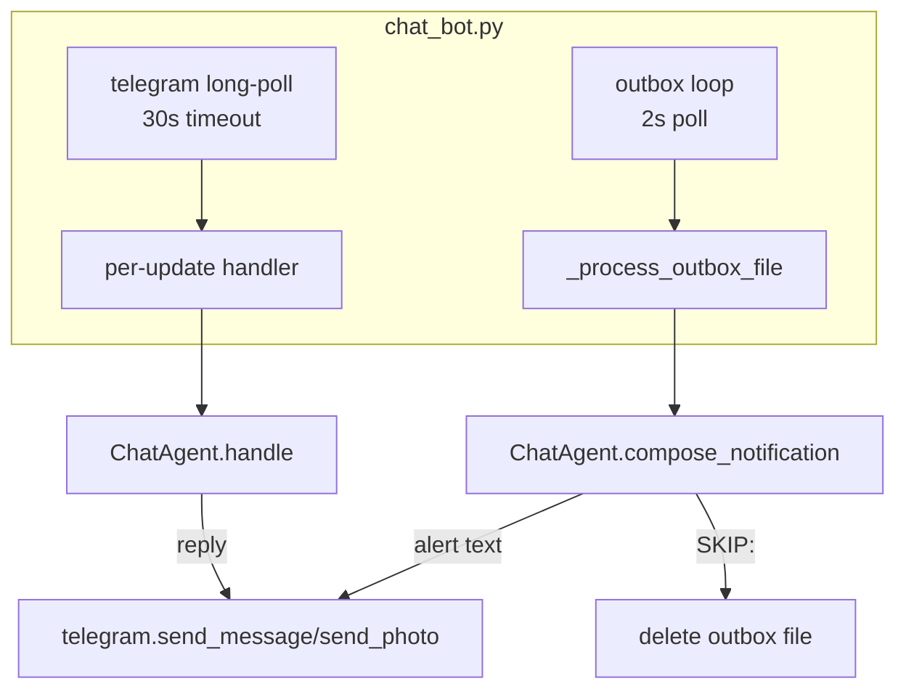

# Chatbots

There is one `ChatAgent` class that serves two roles:

- **Notifier** (`compose_notification`) — called on every new event
  pulled from the outbox. Decides whether to SKIP the event or produce
  a user-facing alert, and records daily-memory side effects.
- **Chat agent** (`handle`) — called on every user message received
  from Telegram. Answers the user, can fetch event details, send
  pictures/videos, write to daily memory, or save long-term facts.

Both run inside the `chat_bot.py` process, share one Gemini client,
one memory store, one daily store, and one set of persistent files.

← [Back to overview](README.md)

## Process shape — `chat_bot.py`

Two async tasks running concurrently in the same event loop:

### Outbox loop — `_outbox_loop`
Polls `events/outbox/*.json` every 2 seconds. For each file, calls
`_process_outbox_file` which:

1. Reads `{"event_id": ..., "prompt": ...}` from the JSON.
2. Resolves the thumbnail path via `EventTools.get_event_details` so
   the alert can be sent as a photo-with-caption when possible.
3. Calls `ChatAgent.compose_notification(prompt)`.
4. If the return text starts with `SKIP` (case-insensitive), logs
   the reason and deletes the outbox file with no Telegram send.
5. Otherwise strips the leading tone tag (`<cautious>`, `<friendly>`,
   `<informative>`) and sends the text to Telegram — as a photo if a
   thumbnail is available, else plain text.
6. Appends the delivered alert to chat history via
   `ChatAgent.append_notification`, so the chat agent is aware of
   what the notifier already said when the user replies.
7. Deletes the outbox file.

On Telegram send failure or `compose_notification` exception the
outbox file is **kept** so it retries next tick. On malformed JSON
or empty prompt the file is deleted.

### Telegram long-poll loop — `_run`
Calls `telegram.get_updates(offset, timeout=30)`. For each update:

1. Drop the message if the chat_id is not the configured
   `TELEGRAM_CHAT_ID`.
2. Handle `/clear` as a special case — calls
   `ChatAgent.clear_history(chat_id)` and replies with the number
   of turns cleared.
3. Otherwise start a "typing..." indicator task, call
   `ChatAgent.handle(chat_id, text)`, cancel the typing task, and
   send the reply.
4. If the reply is empty or the literal sentinel `SILENT`, send
   nothing (used after media tool calls where a follow-up message
   would be redundant).

## `ChatAgent`

Single long-lived instance with:

- `self.memory: Memory` — persistent long-term file.
- `self.daily: DailyContext` — per-day ephemeral files.
- `self.tools: EventTools` — read-side event tools.
- `self._client` — Gemini API client.
- `self._tool_config` — full chat tool set.
- `self._notify_tool_config` — slim notify tool set (writes only).

### `compose_notification(prompt)`
Stateless w.r.t. chat history. Runs a tool-calling loop (up to
`MAX_TOOL_ROUNDS=6`) with a system instruction built from
`chat_notify.system.txt` + pre-fetched memory + day notes (see
[prompt_construction.md](prompt_construction.md)).

Notify tool set is **writes only**: `note_today`, `clear_today`.
Day notes for the active event day are already in the system prompt
so no read tool is needed. This removes one round-trip from the
typical compose.

Return value:
- `SKIP: <reason>` — suppressed by the notifier's rules. The chat_bot
  logs the reason and drops the outbox file.
- Tone-tagged alert text (`<cautious>`, `<friendly>`, `<informative>`)
  — the chat_bot strips the tag and delivers as photo-with-caption
  or plain text.

Side effects the notifier performs during the tool loop:
- `note_today("alerted: <signature> at <location>", time=<event_time>)`
  — writes a canonical recurrence signature after every delivered
  alert, so the *next* similar event can SKIP as a duplicate.
- `note_today("package dropped on porch ...", ...)` — tracks open
  situations (package, visitor inside, vehicle parked).
- `clear_today("package dropped ...")` — when a tracked situation
  resolves.

### `handle(chat_id, user_text)`
Stateful across turns via a sliding window of the last
`HISTORY_WINDOW=10` user/model exchanges, persisted as
`state_dir/chat_history/<chat_id>.json`. Each turn:

1. Append the user message to history and save.
2. Build system prompt with memory + active-day notes.
3. Tool-calling loop (up to 6 rounds) on Gemini.
4. If the final text is empty or `SILENT`, return `""` without
   persisting — `chat_bot.py` suppresses the Telegram send.
5. Otherwise persist the model reply to history and return it.

Full chat tool set (`_tool_declarations`):

| Tool | Type | Purpose |
| --- | --- | --- |
| `list_event_dates` | read | `[YYYY-MM-DD, ...]` of days with events |
| `list_events` | read | compact summaries for one day |
| `get_event_details` | read | full record for one event_id |
| `send_thumbnail` | media | send the event's photo to Telegram |
| `send_video` | media | send the full clip to Telegram |
| `remember` | write | append an identity-level fact to persistent memory |
| `forget` | write | remove matching lines from persistent memory |
| `note_today` | write | append to the active-day daily file |
| `clear_today` | write | remove matching lines from the active day |
| `get_day_notes` | read | fetch daily notes for a PAST day (not the active day — that's pre-loaded) |

After a successful `send_thumbnail` / `send_video`, the chat agent is
instructed to reply with the literal sentinel `SILENT` so no
redundant "here it is" chat message follows the media.

## The `SKIP:` and `SILENT` sentinels

Two single-word sentinels let the LLM express "do nothing further":

- `SKIP: <reason>` — returned from the notifier when the LLM judges
  an event not worth interrupting the homeowner for. The reason after
  the colon is logged but never sent to the user. Matched by
  `startswith("SKIP")` so any reason text is fine.
- `SILENT` — returned from `handle` after a media tool call, so the
  chat bot doesn't send a redundant follow-up message. Exact-match
  check (case-insensitive).

Both keep the protocol text-only — no out-of-band signaling, no
extra API shape. The prompts in `prompts/` spell out when each
sentinel applies.

## Concurrency notes

- The outbox loop and the Telegram loop share one `ChatAgent`
  instance. They interleave at `await` points inside Gemini / HTTP
  calls.
- All daily writes resolve the target day from
  `self._latest_event_date()` at the moment of the call, so there's
  no cross-contamination between a chat turn and a concurrent
  notify compose.
- `self._history_lock` serializes per-chat history reads / writes
  across turns — the chat agent's sliding window can't be torn by
  concurrent appends.

## Common failure modes

- **Tool loop exceeds `MAX_TOOL_ROUNDS=6`** — the final response
  text is `(tool loop exceeded)` and that's what gets returned. For
  notify this becomes the alert text (bad), so the prompt limits
  the notifier to a small fixed set of side-effect tools and a
  single final text turn.
- **Telegram send fails** — outbox file is kept, retried next poll.
  Persistent Telegram outage fills the outbox directory until the
  token is fixed.
- **Gemini API error** — the tool loop raises, the outbox file is
  kept, and the loop moves on. Errors are logged with
  `log.exception`.

## See also

- [Prompt construction](prompt_construction.md) — how
  `_system_with_memory` assembles the system prompt.
- [Memory](memory.md) — the two memory stores the chatbots read and
  write.
- [Event loading](event_loading.md) — what's in the outbox prompt
  before the notifier sees it.
