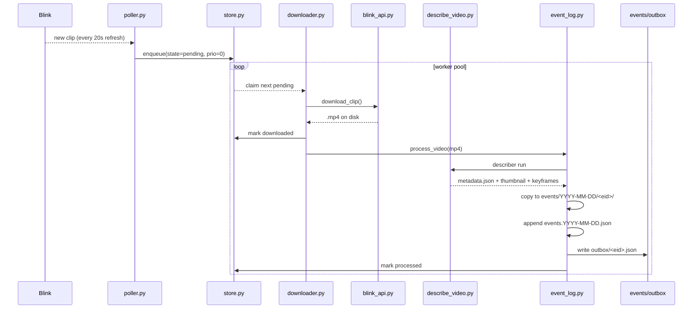

# Event Loading

How a Blink motion event travels from the camera to a persisted event on
disk, ready to be announced to the homeowner.

← [Back to overview](README.md)

## Stages



## Components

### `poller.py` — `LivePoller`
Refreshes the Blink API on a fixed interval (`POLL_INTERVAL_SECONDS`,
default 20s). For each new clip discovered since initialization time,
it enqueues the clip into `store.py` at priority 0 (normal live
traffic). Duplicate suppression relies on the store's unique `id`
column — `store.enqueue()` is a no-op if the id already exists.

The poller does not download anything itself — it just populates the
queue. This decouples the fast discovery loop from the slower
download + describe loop.

### `store.py` — SQLite queue (WAL mode)
Two tables:

- **`events`** — the clip queue. Columns: `id`, `camera`, `ts`,
  `source_url`, `path`, `state`, `priority`, `attempts`, `error`.
  State transitions: `pending → claimed → downloaded → processed`
  (or `failed` from any point). The indexes on `state, priority, ts`
  make the downloader's "next clip to work on" query fast.
- **`backfill_state`** — one row tracking the in-progress historical
  backfill (cursor, target window, started_at). Lets the backfill
  resume safely after a restart.

WAL mode means the poller can write while the downloader reads without
blocking. The SQLite file lives at `state_dir/store.sqlite`.

### `downloader.py`
Worker pool with configurable concurrency. Each worker:

1. `store.claim()` one pending clip, highest priority first.
2. Check disk budget (`MAX_DISK_GB`). If exceeded, the worker pauses.
3. `blink_api.download_clip()` — actually pulls the video file.
4. `store.mark_downloaded()` + `store.mark_processed()` on success,
   `mark_failed()` on any exception (with the error string captured).
5. `event_log.process_video()` — runs the describer and writes the
   event record.

### `blink_api.py` + `auth.py`
`auth.py` handles the initial Blink login and caches the session
token to disk so subsequent startups don't re-trigger 2FA. If 2FA is
required, it looks for `BLINK_2FA_CODE` in env and raises
`TwoFARequired` if missing.

`blink_api.py` is a thin layer over `blinkpy` that exposes two
async functions:

- `list_clips(cameras, since)` — yields `Clip` dataclasses for any
  clip on the allowed cameras newer than `since`.
- `download_clip(clip, dest)` — writes the `.mp4` to `dest`.

### `event_log.py` — `process_video`
This is the handoff point from the video pipeline to the event store.
For each downloaded clip:

1. Run the describer (via `describe_video.py`) if metadata isn't
   cached. The token-saver fast-path reuses an existing
   `<clip>.json` if the describer was already run.
2. Allocate an event ID: `YYYY-MM-DD-HH-MM-SS-NN` where `NN` is a
   2-digit collision counter for events in the same second.
3. Create `events/YYYY-MM-DD/` if needed and move/copy the video,
   metadata JSON, thumbnail, and keyframe directory into it, all
   named after the event id (flat per-date layout, no per-event
   subfolder).
4. Append a compact summary entry to `events/events.YYYY-MM-DD.json`:

   ```json
   {
     "event_id": "2024-06-15-10-22-18-00",
     "recorded_at": "2024-06-15T10:22:18-07:00",
     "video": "events/2024-06-15/2024-06-15-10-22-18-00.mp4",
     "metadata": "events/2024-06-15/2024-06-15-10-22-18-00.json",
     "thumbnail": "events/2024-06-15/2024-06-15-10-22-18-00.jpg",
     "summary": {
       "description": "...",
       "actions": ["person_walking"],
       "people": [{"appearance": "adult", "appearance_details": "..."}]
     }
   }
   ```

5. Decide whether the event deserves a notification. If so, write an
   outbox file at `events/outbox/<event_id>.json`:

   ```json
   {
     "event_id": "2024-06-15-10-22-18-00",
     "prompt": "offer_media: true\n<raw event description fed to the notifier LLM>"
   }
   ```

6. `store.mark_processed()`.

The outbox is the only thing `chat_bot.py` watches — it's the
hand-off between the video pipeline and the notification pipeline.

### `event_tools.py` — `EventTools`
The read side, exposed as tools to the chat agent (see
[chatbots.md](chatbots.md)). Methods:

- `list_event_dates()` → `[YYYY-MM-DD, ...]` from the `events.*.json`
  filenames in `events/`. This is also what
  `ChatAgent._latest_event_date()` reads to decide where daily
  writes should land.
- `list_events(date)` → compact summaries from a single day's index file.
- `get_event_details(event_id, date?)` → full event record.
- `send_thumbnail(event_id, date?)` / `send_video(event_id, date?)` —
  sends the media to Telegram via `telegram.py`. Both validate paths
  stay inside `events/` (no `..` escapes).

### `backfill.py`
Historical ingestion. Walks back in 6-hour chunks from a cursor,
enqueuing clips at priority 1 (higher than live clips at priority
0 — the backfill gets precedence in the downloader until it
catches up). The cursor is persisted so a restart resumes where it
left off. A `--dry-run` flag lists what would be enqueued without
actually writing.

## Key design choices

- **Queue-based.** The SQLite queue decouples discovery speed from
  download speed, so a burst of motion events doesn't overwhelm the
  Blink API or the describer.
- **Exactly-once-ish.** The `pending → claimed → downloaded →
  processed` state machine plus `attempts` counter means a crash
  between stages replays the affected clip on restart without
  duplicating side effects.
- **Outbox, not inline notification.** Writing a JSON file and
  letting another process drain it means the notification path can
  crash, restart, or be tuned independently of the video pipeline.
  If Gemini is slow or Telegram is down, outbox files just pile up
  and get drained when things recover.

## On-disk shape (recap)

```
events/
  events.2024-06-15.json                          # index for that day
  events.2024-06-16.json
  2024-06-15/
    2024-06-15-10-22-18-00.mp4
    2024-06-15-10-22-18-00.json                   # describer output
    2024-06-15-10-22-18-00.jpg                    # thumbnail
    2024-06-15-10-22-18-00.keyframes/
  outbox/
    2024-06-15-10-22-18-00.json
data/
  store.sqlite
```

## See also

- [video_analysis.md](video_analysis.md) — what the describer actually
  produces for each clip.
- [chatbots.md](chatbots.md) — how the outbox is drained into a
  Telegram alert.
